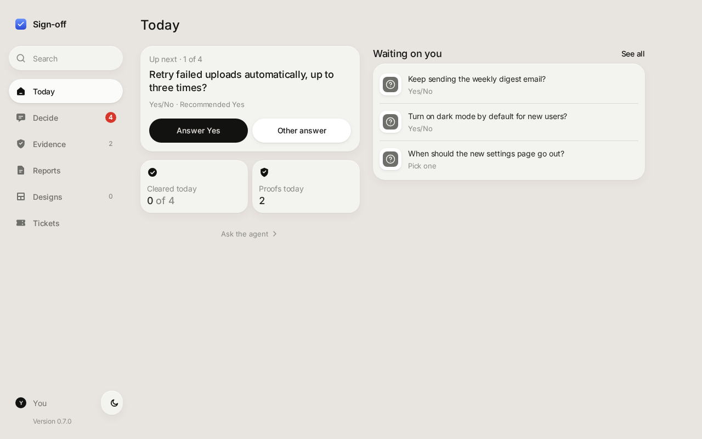
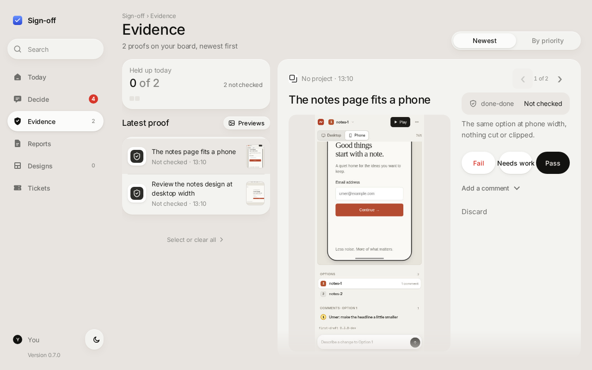
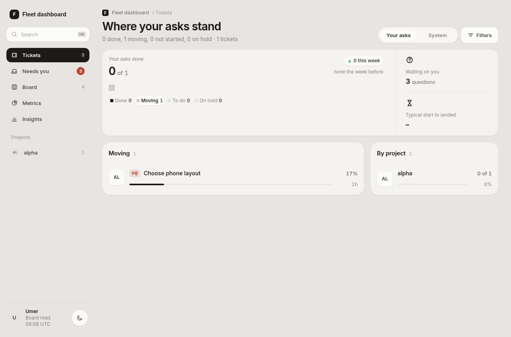
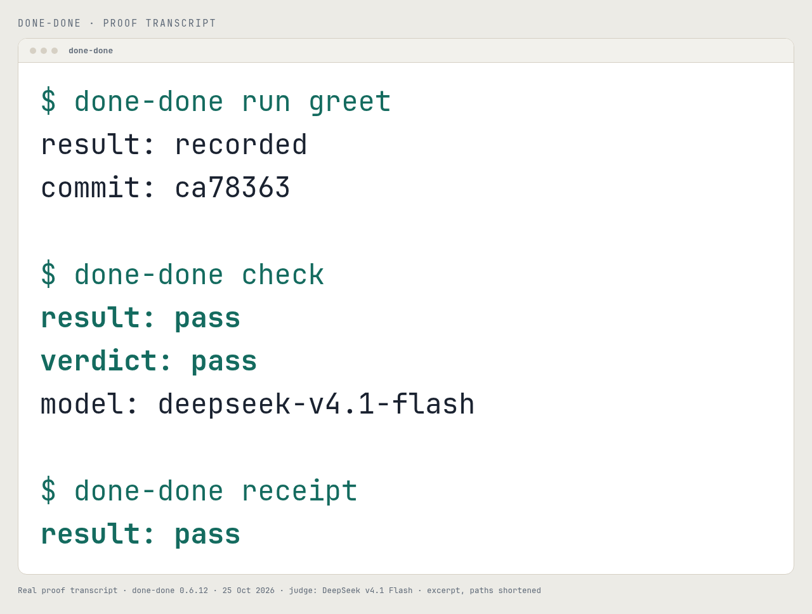
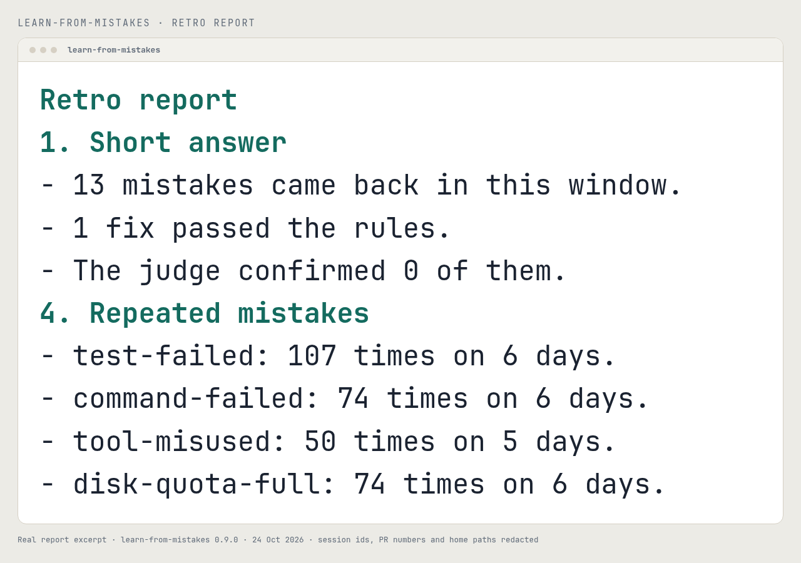
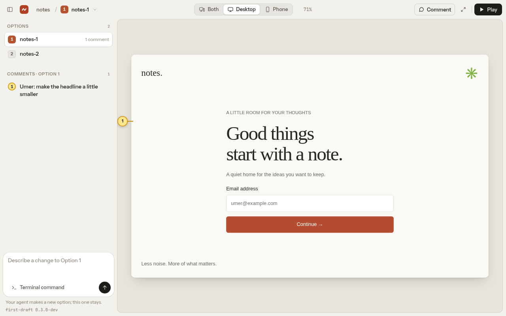
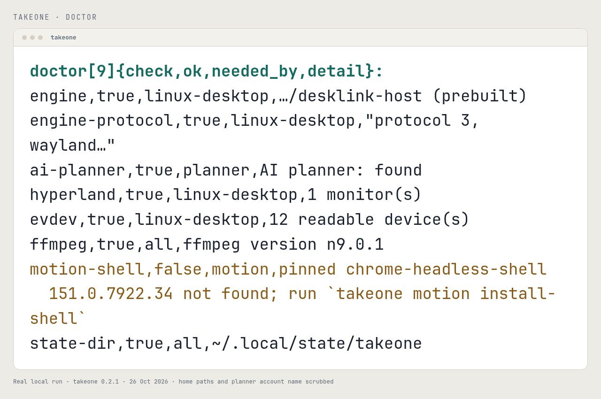
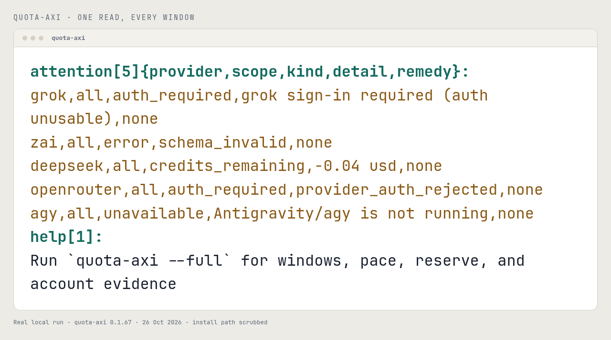
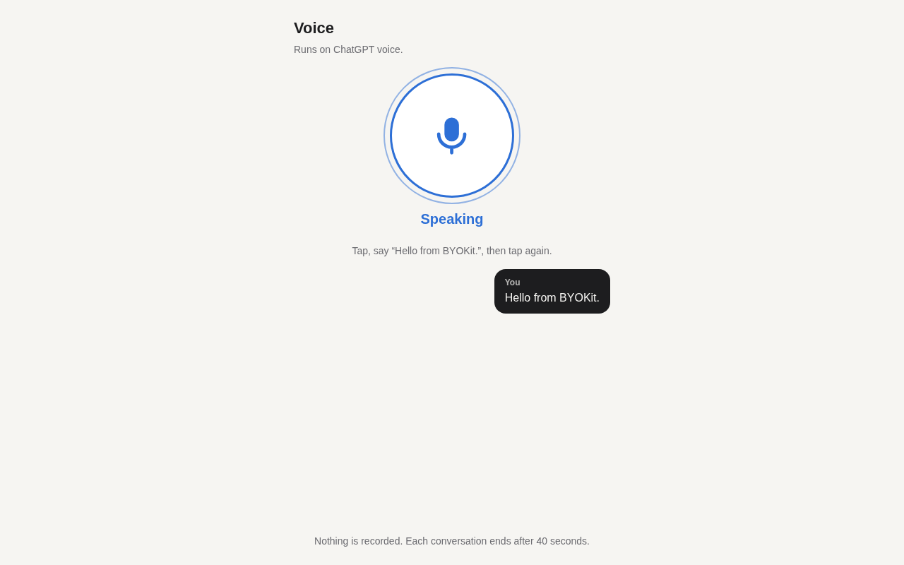
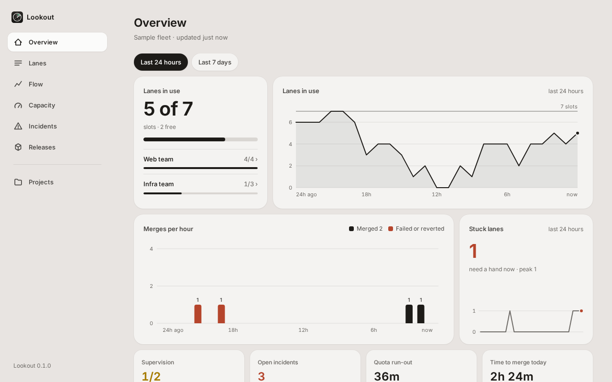

<p align="center">
  <picture>
    <source media="(max-width: 600px) and (prefers-color-scheme: dark)" srcset="assets/hero-mobile-dark.png">
    <source media="(max-width: 600px)" srcset="assets/hero-mobile-light.png">
    <source media="(prefers-color-scheme: dark)" srcset="assets/hero-dark.png">
    
  </picture>
</p>

<p align="center">
  <a href="#what-it-is">WHAT IT IS</a> ·
  <a href="#features">FEATURES</a> ·
  <a href="#how-it-works">HOW IT WORKS</a> ·
  <a href="#quick-start">QUICK START</a> ·
  <a href="#built-in-skills">SKILLS</a> ·
  <a href="#tools">TOOLS</a> ·
  <a href="#documentation">DOCS</a>
</p>

<p align="center">
  <a href="https://github.com/umeranjum17/juggernaut"></a>
  <a href="https://x.com/umership"></a>
</p>

<p align="center"><sub><strong>Ship like it's a game.</strong> · Talk to one agent. Ship with a crew.</sub></p>

<p align="center"></p>

## What it is

You can run one coding agent easily. But the moment you want three missions running at once — fixes, recons, plans, audits — you become a tab-juggler: babysitting sessions, copy-pasting context between repos, forgetting which terminal had the failing test.

| The tab-juggler | The Juggernaut |
|---|---|
| Three missions, three terminals. You are the router, the memory, and the status board. | One liaison. The Overwatch dispatches the squad, each operator in its own worktree, and reports plain objectives secured. |

Juggernaut flips the model. You talk to a single agent — the **Overwatch** — and it runs the squad for you: spawning autonomous operators in a visible session backend, giving each a clean git worktree, supervising them to the objective, and handing you finished PRs, approved local merges, or standalone recon reports.

For larger fleets, you can opt in to persistent secondmates: second mates that are still ordinary direct reports, but run from their own isolated Juggernaut homes on this machine or another SSH-reachable host.

> Juggernaut is not a model, not a harness, not a skill, not an MCP server, and not a CLI. It is an **agent distro** for running a squad of agents.

An agent distro is a portable directory of instructions, skills, tooling, policies, and state conventions that turns a general-purpose agent into a specialized one. There is no app to install: the cloned repo is the distro — `AGENTS.md`, bundled Juggernaut skills, and helper scripts that any terminal coding agent can follow. Launching a supported harness inside it for your primary session instantiates your Overwatch — and makes you the Captain.

<p align="center"></p>

## Features

### Command

- **One liaison** — you talk only to the Overwatch; it dispatches, supervises, escalates only real decisions, and reports plain objectives secured.
- **A visible squad** — every operator works in its own tmux window or Herdr tab, or in an experimental Zellij, cmux, or worker-runtime terminal you can watch or type into; the Overwatch reconciles.
- **Explicit project modes** — each project ships via `no-mistakes`, `direct-PR`, or `local-only`, with optional `+yolo` merge autonomy, a `branch=<prefix>` override for the default `fm/` ship-branch prefix, and a `forge=gerrit` binding that publishes a Gerrit change instead of a pull request.

### Mission

- **Two mission shapes** — ship missions deliver authorized changes; recon missions leave standalone findings when the intake contract warrants separate research.
- **Isolated work copies** — each mission runs in its own clean copy of the repository, so parallel work on one repo never collides.
- **Event-driven, zero-token supervision** — a monitor sleeps on the fleet and wakes the Overwatch only when something needs you; verified harnesses also get a turn-end backstop.
- **Restart-proof** — all state lives on disk and in the active session backend; the next session reconciles after a restart, and ordinary supervision recovers confirmed-dead operators.

### Boundaries

- **Self-repo boundary** — a home runs as a Juggernaut user/operator by default; publishing to Juggernaut's own repository needs the `config/firstmate-role` maintainer opt-in or per-mission Captain consent ([schema](docs/configuration.md#juggernaut-role-configfirstmate-role)).
- **Strict project boundary** — the Overwatch is read-only over your projects except the narrow, Captain-approved operations in [hard rule 1](AGENTS.md#1-identity-and-prime-directives), including fleet sync's guarded safe branch pruning; operators make every other change behind the merge authority.

### Scale and reach

- **Optional secondmates** — opt in to persistent second mates in isolated Juggernaut homes with their own `FM_HOME`, state, projects, and session lock, locally or on an SSH-reachable host, with guarded updates and recovery.
- **Optional Relay** — opt in with one local `.env` pairing token so Juggernaut can answer public X and Discord mentions through the same lifecycle as chat, acknowledge spawned work, and post up to three public-safe follow-ups within seven days; dry-run previews would-be replies locally.

Full detail on every feature lives in [docs/architecture.md](docs/architecture.md).

<p align="center"></p>

## How it works

<p align="center">
  <picture>
    <source media="(max-width: 600px) and (prefers-color-scheme: dark)" srcset="assets/diagrams/how-it-works-mobile-dark.svg">
    <source media="(max-width: 600px)" srcset="assets/diagrams/how-it-works-mobile-light.svg">
    <source media="(prefers-color-scheme: dark)" srcset="assets/diagrams/how-it-works-dark.svg">
    
  </picture>
</p>

You are the **Captain**. You choose the objective and make the calls that matter.

**Overwatch** is your one point of contact. It reads your projects, turns a request into a brief, picks the squad, and keeps the watch. Supervision is event-driven: Overwatch sleeps on the fleet and wakes only when a lane needs you, finishes, or stalls, so ordinary work costs no supervision tokens.

A **Squad Lead** is a persistent Operator with its own home and charter. It holds the context for one project or one part of the fleet, so the next mission does not restart from zero. Squad Leads are optional: a small fleet runs with Overwatch and Operators directly.

An **Operator** does one mission in an isolated work copy. It returns a pull request, an approved local merge, or a report with findings. **Recon** is the findings-only shape: it ends with findings, not a change.

Every mission follows the same delivery path:

1. **Brief** - the objective, the boundary, and the agreed finish line.
2. **Isolated work copy** - a clean git worktree, so parallel work never collides.
3. **Validation** - the project's own checks, proof from the real product, and a judge for any claim of "done".
4. **Pull request** - the change, its evidence, and a checks block that cites both.
5. **Merge** - only inside the authority you gave that project.

The **review board** carries decisions, evidence, and proof back to you. Your answer returns to the Operator that asked, so the mission continues without a pasted transcript. A verified result is an **objective secured**. The mission is complete only when its agreed finish line is met.

<p align="center"></p>

## Quick start

### Requirements

- A verified primary agent harness: Claude Code, Grok, Pi, `pi-signed`, Oh My Pi (`omp`), Codex, OpenCode, or Cursor Agent CLI.
- Git and the GitHub CLI, authenticated through `gh auth login`.
- The CLI and dependencies for your selected runtime backend; tmux is the reference default.

The Overwatch detects and offers to install supported missing tools after you approve. Backend-specific setup is linked in [Documentation](#documentation).

### Install and launch

```sh
gh auth login
gh repo clone umeranjum17/juggernaut
cd juggernaut
```

Then launch one of the co-primary harnesses; `AGENTS.md` takes over from there:

| Harness | Launch |
|---|---|
| **Claude Code** | `claude` |
| **Grok** | `grok --trust` |
| **Pi** | `pi` — or `FM_PI_HARNESS=pi-signed pi-signed` when the signed wrapper is installed |
| **Oh My Pi** | `omp` — or `FM_OMP_HARNESS=omp omp` from inside a Claude Code pane |

Codex, OpenCode, and Cursor Agent CLI are also verified primaries. See the harness notes below.

<details>
<summary><strong>Harness notes</strong></summary>

**Claude Code, Grok, and Pi are equal co-primary recommendations** for running the primary Juggernaut session, with `pi-signed` supported as Pi's distinct signed-wrapper identity. Claude Code uses a tracked Stop hook for tokenless watcher re-arm and rewake, Grok uses background-notify wake cycles, and Pi uses its tracked primary watcher extension. All three have verified turn-end guard paths when launched with their documented setup. Pick whichever one matches your subscription and workflow.

Oh My Pi (`omp`), a Pi fork, is verified as a primary with the same extension-owned watcher model as Pi and a stronger turn-end guard: its blocking `session_stop` hook compels a continuation instead of requesting one. Start `omp` with this checkout as its working directory: it auto-discovers the tracked `.omp/extensions/*.ts` files with no trust dialog, and naming them with `-e` as well would load each twice.

Codex and OpenCode are also verified and supported as primary harnesses; Codex uses bounded foreground checkpoints, and OpenCode uses a TUI plugin, so both carry more harness-specific supervision tradeoffs than the three co-primaries.

Cursor Agent CLI is verified as a primary too, using a tracked project-scope `.cursor/hooks.json` whose `stop` hook parks on the watcher between turns, closest in shape to Claude Code's. Launch it with `--trust`, or none of its project hooks load; it also has no turn-end hook in headless `cursor-agent -p`, so run the primary session interactively.

For Grok, `--trust` is needed once per clone so project hooks and the turn-end guard load; `/hooks-trust` inside Grok works too. For Pi, approve the project trust prompt once per clone on first launch so the tracked `.pi/extensions/*.ts` files auto-load.

The `/calm` toggle on Pi, and on Claude Code behind its default-off early-access function-hooks flag, hides supported transcript chrome, including canonically classified Juggernaut operational user rows, and uses a Calm-only animated working boat during active runs while preserving all model context and session data. Calm changes only presentation, not the user-role delivery, ordering, authority, persistence, or exports of the operational inputs it hides. The preference persists for the effective Juggernaut home, and toggling it off restores ordinary rendering. [Calm's current behavior and supported limits](docs/calm.md) are separate from its [version-scoped maintainer evidence](docs/calm-mode-feasibility.md).

Pi's `/supervision-model` command pins a cheaper model and a shallower reasoning effort for the supervision branch alone, from the eligible models and thinking levels Pi itself reports; with no pin, the branch normally follows your own conversation's model and effort. See the [configuration schema](docs/configuration.md#pi-supervision-branch-model-and-effort-configsupervision-branch-model-configsupervision-branch-effort).

</details>

### Talk to it

```sh
> ahoy! look at my project xyz
  fix flaky login test, add dark mode

# Checks toolchain, asks before installing.
# Clones the project, spawns two operators.
# Minutes later:

  PR ready for review, Captain:
  https://github.com/you/xyz/pull/42
  (login test - risk: low - CI green)

> alright merge it
```

<p align="center">
  <picture>
    <source media="(max-width: 600px) and (prefers-color-scheme: dark)" srcset="assets/secured-mobile-dark.png">
    <source media="(max-width: 600px)" srcset="assets/secured-mobile-light.png">
    <source media="(prefers-color-scheme: dark)" srcset="assets/secured-dark.png">
    
  </picture>
</p>

### More backends

Setup guides for tmux (the default) and every other supported runtime are linked in [Documentation](#documentation) below.

<p align="center"></p>

## Built-in skills

Juggernaut ships these user-invocable built-in skills. Claude and Grok use the slash form shown here; Codex uses the same names with `$`, such as `$afk`.

- **`/afk`** — away-mode supervision: Pi's in-process branch, a [supervision host](docs/configuration.md#supervision-host-configsupervision-host), or the daemon handles wakes while you step away. See the [away procedure](.agents/skills/afk/SKILL.md) for the posture and return contract.
- **`/quiet`** — keep routine wakes off main while you stay and chat; `/quiet off` ends it.
- **`/ahoy`** — recap session events and unanswered Captain decisions, then walk open decisions one at a time.
- **`/bearings`** — four-section fleet sitrep; `file` writes a dated report, `include PRs` adds live GitHub enrichment.
- **`/updatefirstmate`** — guardedly update Juggernaut and its secondmates, then restart live mates on the target commit.
- **`/stow`** — sweep the session for uncaptured durable knowledge and report what is safe to reset.

Bearings invocation examples:

- `/bearings` returns the four-section sitrep in chat only.
- `/bearings file` writes today's dated `data/status-report-<YYYY-MM-DD>.md`.
- `/bearings file include PRs` adds live PR enrichment.

Agent-only reference skills live under `.agents/skills/` and are loaded by Juggernaut at the trigger points named in [`AGENTS.md`](AGENTS.md).

### Two-tier skill layout

Juggernaut's skills live in two separate places with different audiences:

- `.agents/skills/` — agent-loaded skills for live Juggernaut homes. Each carries `metadata.internal: true`, which hides it from installer discovery such as the [skills.sh](https://skills.sh) `npx skills add` installer.
- `skills/` — public, installer-facing skills meant to stand alone in any project; today that is `skills/stow`, a generic session-knowledge-sweep skill.

<p align="center"></p>

## Tools

The squad ships with a small toolbelt. Every tool works on its own, and every hook into Juggernaut is optional. The board and the fleet dashboard are part of Juggernaut; the rest are separate packages.

Every screen below is a real capture from the tool's own current or most recent build, at desktop and phone width, in light and dark. The projects, names, and work shown are demo data. A terminal screen is the tool's own output.

### The review board: answer on the go

Sign-off collects the questions, designs, reports, and proof that need a person, and saves each answer for the agent that asked.

<p align="center">
  <picture>
    <source media="(max-width: 600px) and (prefers-color-scheme: dark)" srcset="assets/tools/sign-off/board-390-dark.png">
    <source media="(max-width: 600px)" srcset="assets/tools/sign-off/board-390-light.png">
    <source media="(prefers-color-scheme: dark)" srcset="assets/tools/sign-off/board-1280-dark.png">
    
  </picture>
</p>

<p align="center">
  <picture>
    <source media="(max-width: 600px) and (prefers-color-scheme: dark)" srcset="assets/tools/sign-off/evidence-390-dark.png">
    <source media="(max-width: 600px)" srcset="assets/tools/sign-off/evidence-390-light.png">
    <source media="(prefers-color-scheme: dark)" srcset="assets/tools/sign-off/evidence-1280-dark.png">
    
  </picture>
</p>

### The fleet dashboard: see the whole board

The built-in dashboard reads the fleet read-only and shows what is moving, what waits on you, and what the work is proving. It needs no separate install.

<p align="center">
  <picture>
    <source media="(max-width: 600px) and (prefers-color-scheme: dark)" srcset="assets/tools/fleet-dashboard/dashboard-390-dark.png">
    <source media="(max-width: 600px)" srcset="assets/tools/fleet-dashboard/dashboard-390-light.png">
    <source media="(prefers-color-scheme: dark)" srcset="assets/tools/fleet-dashboard/dashboard-1280-dark.png">
    
  </picture>
</p>

### The toolbelt

| Tool | What it does and how to install it |
| --- | --- |
| **done-done** | Drives the real product, has a fresh judge check the capture, and writes a receipt tied to the commit.<br>`npm install -g done-done-axi@0.6.18` |
| **sign-off** | Collects questions, designs, reports, and proof on one board; the answer is saved for the agent.<br>`npm install -g sign-off-axi@0.7.0 (0.8.0 once sign-off PR 303 releases)` |
| **learn-from-mistakes** | Finds the causes that keep coming back in your records, with counts, evidence, and fixes that cite the record.<br>`npm i -g learn-from-mistakes-axi@0.10.0` |
| **first-draft** | Makes several HTML design directions, lets you compare them at desktop and phone width, and keeps the one you pick.<br>`npm install -g first-draft-axi@0.3.0` |
| **TakeOne** | Turns a raw screen recording into a framed, paced demo video on your machine.<br>`npm install -g --allow-remote=all https://github.com/umeranjum17/takeone/releases/latest/download/takeone.tgz (0.2.1)` |
| **quota-axi** | Reports the quota windows your local agents can use, in one read, without routing or recommending anything.<br>`npx -y quota-axi@0.1.67` |
| **BYOKit** | Gives your app the parts it needs to use a person's own AI plan and devices: sign-in, pairing, voice, usage.<br>`npm install @byokit/accounts@0.34.0 @byokit/realtime@0.3.3` |
| **Lookout** | A read-only fleet dashboard: which agents need you, what limits capacity, and why work is waiting.<br>`npx -y lookout-axi@0.1.0 serve` |

<p align="center">
  <picture>
    <source media="(max-width: 600px) and (prefers-color-scheme: dark)" srcset="assets/tools/done-done/390-dark.png">
    <source media="(max-width: 600px)" srcset="assets/tools/done-done/390-light.png">
    <source media="(prefers-color-scheme: dark)" srcset="assets/tools/done-done/1280-dark.png">
    
  </picture>
</p>

<p align="center">
  <picture>
    <source media="(max-width: 600px) and (prefers-color-scheme: dark)" srcset="assets/tools/sign-off/board-390-dark.png">
    <source media="(max-width: 600px)" srcset="assets/tools/sign-off/board-390-light.png">
    <source media="(prefers-color-scheme: dark)" srcset="assets/tools/sign-off/board-1280-dark.png">
    
  </picture>
</p>

<p align="center">
  <picture>
    <source media="(max-width: 600px) and (prefers-color-scheme: dark)" srcset="assets/tools/learn-from-mistakes/390-dark.png">
    <source media="(max-width: 600px)" srcset="assets/tools/learn-from-mistakes/390-light.png">
    <source media="(prefers-color-scheme: dark)" srcset="assets/tools/learn-from-mistakes/1280-dark.png">
    
  </picture>
</p>

<p align="center">
  <picture>
    <source media="(max-width: 600px) and (prefers-color-scheme: dark)" srcset="assets/tools/first-draft/studio-390-dark.png">
    <source media="(max-width: 600px)" srcset="assets/tools/first-draft/studio-390-light.png">
    <source media="(prefers-color-scheme: dark)" srcset="assets/tools/first-draft/studio-1280-dark.png">
    
  </picture>
</p>

<p align="center">
  <picture>
    <source media="(max-width: 600px) and (prefers-color-scheme: dark)" srcset="assets/tools/takeone/390-dark.png">
    <source media="(max-width: 600px)" srcset="assets/tools/takeone/390-light.png">
    <source media="(prefers-color-scheme: dark)" srcset="assets/tools/takeone/1280-dark.png">
    
  </picture>
</p>

<p align="center">
  <picture>
    <source media="(max-width: 600px) and (prefers-color-scheme: dark)" srcset="assets/tools/quota-axi/390-dark.png">
    <source media="(max-width: 600px)" srcset="assets/tools/quota-axi/390-light.png">
    <source media="(prefers-color-scheme: dark)" srcset="assets/tools/quota-axi/1280-dark.png">
    
  </picture>
</p>

<p align="center">
  <picture>
    <source media="(max-width: 600px) and (prefers-color-scheme: dark)" srcset="assets/tools/byokit/voice-390-dark.png">
    <source media="(max-width: 600px)" srcset="assets/tools/byokit/voice-390-light.png">
    <source media="(prefers-color-scheme: dark)" srcset="assets/tools/byokit/voice-1280-dark.png">
    
  </picture>
</p>

<p align="center">
  <picture>
    <source media="(max-width: 600px) and (prefers-color-scheme: dark)" srcset="assets/tools/lookout/overview-390-dark.png">
    <source media="(max-width: 600px)" srcset="assets/tools/lookout/overview-390-light.png">
    <source media="(prefers-color-scheme: dark)" srcset="assets/tools/lookout/overview-1280-dark.png">
    
  </picture>
</p>

Install lines are copied from each project's published README and pinned to the version published on 26 October 2026; sign-off stays on 0.7.0 until its 0.8.0 release (PR 303) ships. The done-done screen is the project's 0.6.12 transcript, the learn-from-mistakes screen is a 0.9.0 report, and the first-draft screen is 0.3.0-dev release evidence; the install pins are the current published versions. A clean-home install proof for every row is still owed, so treat an install line as the project's documented command, not as a claim that this page ran it end to end.

Two notes on what the screens show:

- The BYOKit screen is the **offline example** (`BYOKIT_EXAMPLE_FAKE=1`): a stand-in sign-in and a stand-in voice peer, with nothing leaving the machine. It is not a live provider connection.
- The done-done screen is a real proof transcript, including the judge's model (DeepSeek v4.1 Flash). Paths are shortened; nothing was re-judged for this page.

<p align="center"></p>

## Documentation

### Architecture and configuration

- [docs/architecture.md](docs/architecture.md) — maintainer architecture for the squad, supervision, worktrees, secondmates, and project modes.
- [docs/configuration.md](docs/configuration.md) — environment variables, `FM_HOME`, runtime backend selection, optional Relay and its X and Discord setup steps, trusted external process-event adapter setup, the files you set, and harness support.
- [docs/extension-bindings.md](docs/extension-bindings.md) — maintainer architecture for the narrow trusted external `process-event-adapter/1` package, binding, handshake, and evidence boundary.
- [docs/remote-secondmates.md](docs/remote-secondmates.md) — current setup, routing, transfer, recovery, and safety behavior for whole-home remote second mates.
- [docs/calm.md](docs/calm.md) — current `/calm` behavior on Pi and Claude Code and its supported presentation limits.
- [docs/voice-relay.md](docs/voice-relay.md) — the optional spoken interface: setup on both machines, measured round-trip cost, what a spoken answer may read, and what this build does not do yet.
- [docs/fleet-ledger.md](docs/fleet-ledger.md) — the opt-in activity ledger outside tools can read to follow a home's missions, and its record contract.
- [docs/wedge-alarm.md](docs/wedge-alarm.md) — configure the active alert for an away-mode escalation delivery that gets stuck.

### Backends

- [docs/tmux-backend.md](docs/tmux-backend.md) — current setup and limits for the tmux reference backend.
- [docs/herdr-backend.md](docs/herdr-backend.md) — current setup, CI coverage, safety boundaries, and limits for the Herdr backend.
- [docs/zellij-backend.md](docs/zellij-backend.md) — current setup and limits for the experimental Zellij backend.
- [docs/orca-backend.md](docs/orca-backend.md) — current setup and limits for the experimental Orca backend.
- [docs/cmux-backend.md](docs/cmux-backend.md) — current setup, socket security, and limits for the experimental cmux backend.
- [docs/codex-app-backend.md](docs/codex-app-backend.md) — the current blocked Codex App backend boundary and rollout contract.

### Verification and integrations

- [docs/verification/runtime-backends.md](docs/verification/runtime-backends.md) — active maintainer verification for runtime backend guarantees.
- [docs/gerrit-forge-integration.md](docs/gerrit-forge-integration.md) — maintainer architecture for the forge axis: why change-shaped review is not a forge variant, the mode/forge/shape composition test, and where responsibility for forge mechanics sits.
- [docs/gitlab-merge-watch.md](docs/gitlab-merge-watch.md) — maintainer verification for watching and merging GitLab merge requests on arbitrary instances.
- [docs/gerrit-change-watch.md](docs/gerrit-change-watch.md) — maintainer verification for watching Gerrit changes read-only, and why the merge path refuses one.
- [docs/forgejo-tea-integration.md](docs/forgejo-tea-integration.md) — maintainer verification for watching and merging Forgejo/Gitea pull requests via `tea`.
- [docs/turnend-guard.md](docs/turnend-guard.md) — the primary session's current "no turn ends blind" backstop, scope, loop safety, and compatibility limits.
- [docs/verification/supervision.md](docs/verification/supervision.md) — active maintainer verification for session-start, guard, continuity, and wedge integrations.
- [docs/supervision-protocols/](docs/supervision-protocols/) — rendered primary-harness watcher protocols for Claude, Codex, OpenCode, Pi and `pi-signed`, omp, Grok, Cursor, and unknown harness fallback.
- [docs/scripts.md](docs/scripts.md) — the `bin/` toolbelt reference.
- [docs/documentation-audiences.md](docs/documentation-audiences.md) — documentation audiences and the machine-checked placement boundary.
- [`AGENTS.md`](AGENTS.md) — the supervision contract, role boundary, and routing index for conditional procedures.
- [CONTRIBUTING.md](CONTRIBUTING.md) — how to contribute, including the dev/test commands.

<p align="center"></p>

## Contributing

Contributions are welcome — see [CONTRIBUTING.md](CONTRIBUTING.md) for the workflow, repo conventions, and how to run the tests.

## License

MIT — see [LICENSE](LICENSE). Juggernaut is a fork of [Firstmate](https://github.com/kunchenguid/firstmate) by Kun Chen; the original MIT copyright and licence notice are preserved in [LICENSE](LICENSE).


